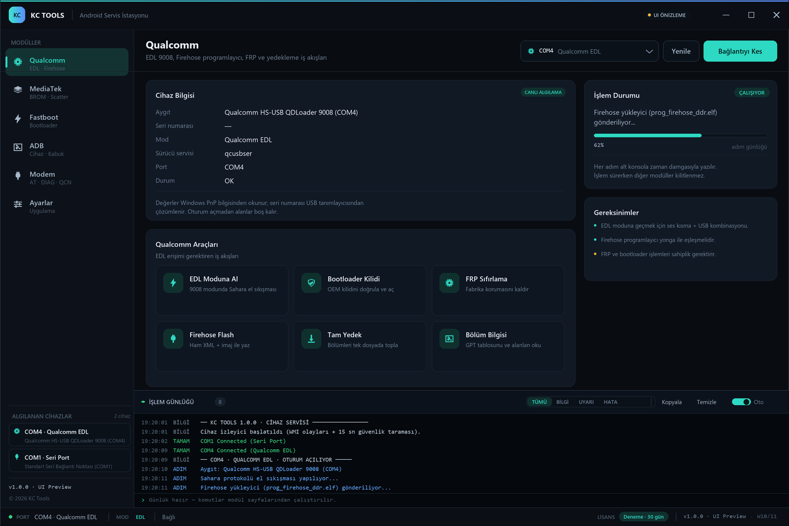

# KC Tools — Android Servis İstasyonu

TR Tools benzeri bir Android servis aracının C# / WPF iskeleti. Üç parça bir arada:

| Parça | Kapsam | Durum |
|---|---|---|
| **1 — Masaüstü arayüzü** | Karanlık Material 3 teması, özel başlık çubuğu, navigasyon, konsol, durum çubuğu, 5 modül sayfası | tamam |
| **2 — Cihaz algılama** | `ManagementEventWatcher` ile anlık USB/COM izleme; Qualcomm EDL / MTK Preloader-BROM / ADB / Fastboot sınıflandırması | tamam |
| **3 — Fastboot & ADB** | `Process` tabanlı `adb.exe` / `fastboot.exe` sarmalayıcıları, canlı çıktı → log paneli, bilgi okuma, kilit durumu, FRP, `fastboot flash` | tamam |
| **4 — Modem / Diag** | `SerialPort` tabanlı async AT komut motoru, IMEI/SIM/sinyal, diag portu ve hex, QCN arama/düzenleme/yedekleme | tamam |
| **5 — İşlemci protokolleri** | Firehose XML paket üretimi (NOP/Read/Write/Erase/Patch), yanıt ayrıştırıcı, sektör/hex veri işleme, MTK DA doğrulama ve blok planı | tamam |
| **6 — Lisans altyapısı** | HWID (anakart/CPU/disk), HTTPS + JWT ile sunucu doğrulama, DPAPI oturum saklama, kredi düşme, referans ASP.NET Core sunucusu, karartma yapılandırması | tamam |
| **7 — Birleştirme & yayın** | Katmanlı mimari, global EventAggregator + günlük dosyası, ortam/sürücü kontrolü, crash sertleştirme, async denetimi, platform-tools kopyalama, Inno Setup kurulum paketi | tamam |
| **8 — Model, recovery, IMEI** | Bağlanan telefonun modelini ADB/fastboot'tan otomatik okuma, tek tık recovery, IMEI okuma + Luhn doğrulama ve QCN üzerinde yedekli IMEI onarımı | tamam |
| **9 — Cihaz panosu** | Bağlanınca cihaz bilgisi (model, yapı, batarya, depolama, root, güvenlik) ve kategori kategori tek tık işlemler: sistem, format, yedekleme, yazılım, kilit, imaj flash | tamam |
| **19 — Masaüstü OIDC** | WPF LoginWindow, tarayıcı+PKCE, CNG cihaz anahtarı, lisans kapısı, 72s imzalı offline doğrulama | tamam |
| **18 — OIDC + PKCE** | OpenIddict, authorization code + S256, JWKS/discovery, `/me/license`, RS256 offline entitlement (72s sınırı) | tamam |
| **17 — Web paneli** | MVC panel: login, dashboard, kullanıcı/lisans/cihaz/süre/audit/ayarlar, müşteri portalı; CSRF, rol koruması, lockout | tamam |
| **16 — Kimlik + cihaz anahtarı** | ASP.NET Core Identity (Admin/Customer, 5/15 dk lockout, bootstrap), ECDSA P-256 challenge/response, tek cihaz, admin reset, aktivasyon geçmişi | tamam |
| **15 — Lisans veritabanı** | PostgreSQL + EF Core: Users, Licenses, Devices, RefreshTokens, AuditLogs; PBKDF2 parola, tek cihaz, tarih aralığı, iptal, refresh rotasyonu, migration | tamam |
| **14 — Root yardımcısı** | Root durumu (kilit/su/Magisk), resmi bootloader kilidi, Magisk APK kurulumu, yamalı boot.img flash ve doğrulama — exploit yok | tamam |
| **13 — Profesyonel onarım** | Kanatlı uçan telefon logosu, QCN yedek listesi + geri yükleme + güvenlik kopyası, SHA-256 doğrulama, klasörden fastboot flash, IMEI kapsam dokümanı | tamam |
| **12 — İşlem geçmişi** | Sağdaki kutuda telefona yapılan son işlemler: yeniden başlatma, fastboot/recovery, silme, yedekleme, flash, kilit açma; zaman damgalı ve durum renkli | tamam |
| **11 — Cihaz kataloğu** | 12 marka / 960 model JSON kataloğu, codename+platform, ADB/Fastboot otomatik eşleştirme, manuel atama, TEST EDİLMEDİ rozetleri, katalog testleri | tamam |
| **10 — TR Tools eşlemesi** | Kurulu TR Tools PRO arayüzünden çıkarılan MediaTek servis listesine göre FRP sıfırlama, aktif slot, bölüm yöneticisi, ağ onarımı, kritik veri yedeği eklendi | tamam |



---

## Hızlı başlangıç

Gereksinim: **.NET 8 SDK** (Windows 10/11) + `System.Management` ve `System.IO.Ports` NuGet paketleri (otomatik).

```powershell
winget install Microsoft.DotNet.SDK.8
dotnet run --project src/KCTools        # veya .\run.ps1
```

**adb / fastboot** için `tools/platform-tools/` klasörüne Android SDK platform-tools
dosyalarını koyun (`adb.exe`, `fastboot.exe`, `AdbWinApi.dll`, `AdbWinUsbApi.dll`).
Araçlar bulunamazsa ADB/Fastboot sayfaları demo akışına düşer, uygulama çalışmaya devam eder.
Ayrıntı: [tools/platform-tools/README.txt](tools/platform-tools/README.txt)

> Uygulama `requireAdministrator` ile başlar. Yalnızca arayüzü denemek için
> `src/KCTools/app.manifest` içindeki değeri `asInvoker` yapın.

## Proje yapısı

```
KCTools.sln
src/KCTools/
├─ MainWindow.xaml                 # başlık çubuğu + navigasyon + cihaz listesi + konsol + durum çubuğu
├─ Themes/                         # Colors · Icons (18 Geometry) · Controls (Material 3 karanlık)
├─ Controls/                       # LogPanel (konsol) · OperationStatusCard
├─ Views/                          # Qualcomm · MediaTek · Fastboot · ADB · Modem · Ayarlar
├─ ViewModels/                     # MainViewModel, PageViewModel, 6 modül VM'i
├─ Models/                         # DetectedDevice, DeviceKind, AdbDevice, FastbootInfo, ModemInfo, QcnMatch ...
├─ Protocol/                       # Firehose XML üretimi + yanıt ayrıştırıcı + MTK DA araçları
├─ Common/                         # ObservableObject, RelayCommand, EventAggregator, Guard, Hex
├─ Security/                       # HWID, JWT okuma, DPAPI oturum, HTTPS API istemcisi
├─ Services/
│  ├─ EnvironmentCheckService.cs   # sürücü / araç / ortam denetimi
│  ├─ LogFileWriter.cs             # günlüğün diske arka plan yazımı
│  ├─ LicenseService.cs            # lisans yaşam döngüsü (aktivasyon/doğrulama/kredi)
│  ├─ FirehoseClient.cs            # Firehose akışı (ACK/NAK, sektör hizalı yazma)
│  ├─ FirehoseTransport.cs         # IFirehoseTransport + loopback simülatörü
│  ├─ SerialTransport.cs           # SerialPort taşıma katmanı (async okuma, satır tamponu)
│  ├─ AtCommandService.cs          # AT komut motoru (OK/ERROR/CME, URC, zaman aşımı)
│  ├─ ModemService.cs              # IMEI / model / SIM / sinyal / operatör sorguları
│  ├─ DiagService.cs               # diag portu, hex gönderim/izleme
│  ├─ QcnDocument.cs               # QCN analiz, IMEI arama, yedekli kaydetme
│  ├─ ProcessRunner.cs             # Process + canlı stdout/stderr + iptal/zaman aşımı
│  ├─ Toolchain.cs                 # adb.exe / fastboot.exe keşfi ve sürümleri
│  ├─ AdbClient.cs                 # adb komutları
│  ├─ FastbootClient.cs            # fastboot komutları
│  ├─ FastbootOutput.cs            # getvar ayrıştırıcı
│  ├─ DeviceWatcher.cs / WmiDeviceScanner.cs / DeviceClassifier.cs   # 2. parça
│  ├─ PortWatcher.cs · LogHub.cs · LicenseService.cs · AppSettings.cs
└─ Common/                         # ObservableObject, RelayCommand, CommandLine, IconLibrary
tools/platform-tools/              # adb.exe / fastboot.exe buraya
server/KCTools.LicenseServer/      # referans lisans API'si (ASP.NET Core + JWT)
installer/kctools.iss              # Inno Setup kurulum betiği
build-release.ps1                  # publish + karartma + installer
docs/preview.png                   # tasarım önizlemesi
docs/TESTING.md                    # stres / crash / lisans test matrisi
obfuscar.xml                       # kod karartma yapılandırması
```

## 3. Parça — Fastboot & ADB katmanı

### ProcessRunner

`adb`/`fastboot` süreçlerini yöneten tek nokta. Tüm çıktı satır satır günlüğe akar.

```csharp
var runner = new ProcessRunner();

var result = await runner.RunAsync(
    fastbootPath,
    new[] { "flash", "boot", "boot.img" },
    cancellationToken,
    timeout: TimeSpan.FromMinutes(10),
    echoCommand: true,     // konsola "> fastboot flash boot boot.img"
    logOutput: true,       // her stdout/stderr satırı anında panele
    logSource: "FASTBOOT",
    onLine: line => { /* ilerleme yüzdesi */ });
```

- `ProcessStartInfo.ArgumentList` — kabuk kaçış sorunu yok, komut enjeksiyonu yok.
- `BeginOutputReadLine` + `BeginErrorReadLine`; `WaitForExitAsync` sonrası parameterless
  `WaitForExit()` ile async okuyucuların boşalması garanti edilir.
- İptal ve zaman aşımı: `CancellationTokenSource` birleştirilir, süreç ağacı
  `Kill(entireProcessTree: true)` ile sonlandırılır.
- Çıktı tamponu varsayılan 400 KB ile sınırlı (logcat gibi akışlarda bellek şişmez).
- `ProcessResult`: `ExitCode`, `StandardOutput`, `StandardError`, `Duration`, `TimedOut`, `Canceled`, `Success`.
- Başlatma hatası bile `ProcessResult` olarak döner; arayüz çökmez.

### Toolchain

`adb.exe` / `fastboot.exe` arama sırası:

```
KCTOOLS_TOOLS → <app>/tools/platform-tools → <app>/platform-tools →
depo köküne doğru 4 üst klasör → ANDROID_HOME / ANDROID_SDK_ROOT →
%LOCALAPPDATA%\Android\Sdk\platform-tools → C:\platform-tools → PATH
```

Sürümler (`adb version`, `fastboot --version`) arka planda okunur ve oturum açılışını
bloklamaz. Ayarlar > **Araç Zinciri** kartında yol, sürüm ve "Yeniden Tara" bulunur.

### AdbClient

| Metot | Komut |
|---|---|
| `ListDevicesAsync` | `adb devices -l` → serial, model, ürün, `transport_id`, durum |
| `GetPropsAsync` | `adb shell getprop` → `[anahtar]: [değer]` sözlüğü |
| `ShellAsync(cmd)` | `adb shell <cmd>` |
| `InstallAsync(apk)` | `adb install -r -d <apk>` ("Failure" çıktısı hata sayılır) |
| `PushAsync` / `PullAsync` | `adb push` / `adb pull` |
| `ScreenshotAsync` | `screencap -p` → `pull` → `rm` |
| `LogcatDumpAsync(n)` | `adb logcat -d -t n` |
| `RebootAsync(target)` | `adb reboot [bootloader|recovery|fastboot]` |
| `RunRawAsync(line)` | serbest komut (`ArgumentList` ile ayrıştırılır) |

### FastbootClient

| Metot | Komut |
|---|---|
| `ListSerialsAsync` | `fastboot devices` |
| `ReadInfoAsync` | `fastboot getvar all` + `flashing get_unlock_ability` |
| `FlashAsync(part, img)` | `fastboot flash <part> ` — Sending/Writing/Finished satırlarından ilerleme |
| `EraseAsync(part)` | `fastboot erase <part>` (FRP = `erase frp`) |
| `UnlockAsync(bool)` | `fastboot flashing unlock` veya `fastboot oem unlock` |
| `RebootAsync` / `RebootBootloaderAsync` | `fastboot reboot [bootloader]` |
| `RunRawAsync(line)` | serbest komut |

**Ayrıştırma notları:** fastboot, `getvar` çıktısını **stderr**'e yazar; bu yüzden
`StandardOutput` + `StandardError` birleştirilip `(bootloader) anahtar: değer` ve
`anahtar: değer` biçimleri okunur. Uzun değerlerdeki `...` kırpma izi temizlenir.

### Arayüz

- **Fastboot:** Cihaz Durumu kartı (bootloader, aktif slot, seri, ürün, bootloader sürümü,
  güvenli önyükleme, `unlock_ability`), **Partisyon Yaz** kartı (partisyon seçimi + imaj +
  Flash düğmesi), ham komut kutusu, 6 işlem kutucuğu.
- **ADB:** gerçek `adb devices -l` listesi (çevrimiçi/yetkisiz renk kodu), `getprop`
  bilgi kartı, komut kutusu, 6 işlem kutucuğu.
- Her komut konsola `[KOMUT]` etiketiyle yazılır; çıktısı `[ADIM]` olarak satır satır akar.

Örnek konsol:

```
[19:41:58] [KOMUT] fastboot flash boot boot.img
[19:41:58] [ADIM]  Sending 'boot' (65536 KB)                        OKAY [  1.234s]
[19:41:59] [ADIM]  Writing 'boot'                                   OKAY [  0.512s]
[19:41:59] [ADIM]  Finished. Total time: 1.746s
[19:41:59] [TAMAM] boot yazıldı · boot.img
```

### Güvenlik ve sınırlar

- Her komutun zaman aşımı var (cihaz listesi 20 sn, kurulum/flash 10 dk, kabuk 60 sn);
  süre dolunca süreç ağacı sonlandırılır.
- Yıkıcı işlemler (`erase frp`, `flashing unlock`, `flash`) günlükte `[UYARI]` ile
  işaretlenir; arayüzde ayrıca onay metinleri bulunur.
- FRP silme çoğu cihazda açık bootloader gerektirir; `unlock_ability=0` ise işlem
  başlatılmaz, kullanıcı yönlendirilir.
- Birden fazla cihaz varsa ilk çevrimiçi cihaz seçilir ve `-s SERI_NO` otomatik eklenir.
- Araç yoksa komut çalıştırılmaz; sayfa demo adımlarına düşer ve bunu `[DEMO]` olarak loglar.

### 12.1 Kilit açma (PIN)

- **Kilidi Aç** düğmesi: PIN/şifre sorulur → `input keyevent 224` (uyandır) →
  `wm dismiss-keyguard` → yukarı kaydırma → `input text <pin>` → `input keyevent 66`
- **"Bu cihazda hatırla"** işaretlenirse PIN yalnızca DPAPI (CurrentUser) ile şifrelenip
  `%LOCALAPPDATA%\KCTools\lock-pin.dat` dosyasına yazılır; bir sonraki bağlantıda otomatik açılır.
  Dosyayı silmek yeterlidir.
- **Sınır:** Bazı ROM'lar (MIUI gibi) ADB giriş enjeksiyonunu kısıtlar
  (`INJECT_EVENTS`). Bu durumda uygulama açıklayıcı hata verir; MIUI'de
  *Geliştirici seçenekleri → USB hata ayıklama (Güvenlik ayarları)* açılmalıdır.
  PIN hiçbir yere gönderilmez.

## 15. Lisans veritabanı (PostgreSQL + EF Core)

- **Şema:** `Users`, `Licenses`, `Devices`, `RefreshTokens`, `AuditLogs`
- **Migration:** `server/KCTools.LicenseServer/Data/Migrations/...InitialCreate.cs` (+ `.sql`)
- **Kurallar:** kullanıcı adı benzersiz, PBKDF2 parola hash'i, lisans başlangıç/bitiş tarihi,
  varsayılan tek bilgisayar, iptal edilen lisans tekrar kullanılamaz, cihaz bağlantıları DB'de,
  yönetici işlemleri `AuditLogs`'a yazılır
- **Geriye uyum:** bağlantı yoksa sunucu eski bellek içi modda çalışır; API yolları değişmez
- **Yeni uç noktalar:** register / login / refresh / admin lisans oluştur-iptal / audit
- Ayrıntı ve örnekler: [docs/LICENSE_DB.md](docs/LICENSE_DB.md)

## 14. Root yardımcısı

Cihaz → **Root** sekmesi, root atmayı **resmi yöntemle** adım adım yürütür:

| Adım | İşlem |
|---|---|
| 1 | **Bootloader kilidi** — `fastboot flashing unlock` (veriler silinir, onay ister) |
| 2 | **Magisk (tek tık)** — resmi GitHub sürümü otomatik indirilir → `adb install` → uygulama açılır; ayrıca APK indirmek gerekmez |
| 3 | **Yamalı boot** — Magisk ile yamalanmış `boot.img` seç → `fastboot flash boot` |
| 4 | **Root kaldır** — `Root'u Kaldır` (tek tuş: Magisk silinir + stok boot yazılır). Stok boot `ZIP'ten Çıkar` ile firmware ZIP'inden üretilir |
| 5 | **Doğrula** — `which su`, `pm list packages`, `ro.boot.flash.locked` yeniden okunur |

Durum kartı: model, seri, bootloader (açık/kilitli), root (su), Magisk, verified boot.
Exploit veya yetkisiz yükseltme kullanılmaz; yalnızca resmi `fastboot`/`adb` komutları.
Uyarılar: veri kaybı, garanti, yanlış `boot.img` ile bootloop, bankacılık/DRM etkisi.

## 13. Profesyonel onarım seti

- **Logo:** kanatlı uçan telefon (`Assets/logo.png` + `kctools.ico`), başlıkta görünür.
- **QCN yedekleri:** IMEI sayfasında `Yedekler` listesi; `Geri Yükle` önce mevcut dosyanın
  güvenlik kopyasını alır; `Doğrula` SHA-256 bütünlüğünü kontrol eder.
- **Klasörden Flash:** Cihaz → Yazılım → `Klasörden Flash`; `boot.img`, `recovery.img`,
  `vendor_boot.img`, `vbmeta.img`… bilinen bölümlere sırayla yazılır, bilinmeyen dosyalar atlanır.
- **Kapsam:** yalnızca dosya + resmi fastboot; root, exploit, NV belleğe yazma ve kimlik
  klonlama yok. Ayrıntı: [docs/IMEI_REPAIR.md](docs/IMEI_REPAIR.md)

## 12. İşlem geçmişi

Cihaz sayfasının sağındaki **İşlem Geçmişi** kutusu, telefona uygulanan işlemleri
zaman damgalı olarak listeler:

- Yeniden başlatıldı · Recovery moduna geçildi · Fastboot moduna geçildi · Kapatıldı
- Veriler silindi · Cache temizlendi · FRP sıfırlandı
- Depolama yedeklendi · Logcat kaydedildi · Kritik veriler yedeklendi
- Sideload / klasörden flash / imaj yazıldı
- Bootloader kilidi açıldı · Kilit açıldı · Cihaz bağlandı/ayrıldı

Her kayıt **saat + başlık + ayrıntı + durum** (yeşil/sarı/kırmızı) içerir; `Temizle`
listeyi boşaltır, `Kilidi Aç` PIN ile telefon kilidini açar. Ekran yansıtma özelliği
kaldırılmıştır.
## 11. Cihaz kataloğu (marka/model veritabanı)

- **Veri:** `Assets/DeviceCatalog.json` (12 marka, 960 model) — yeni model eklemek için JSON yeterli.
- **Eşleştirme:** model kodu → codename → model adı → VID/PID (yalnızca marka) → manuel.
  "KESİN" yalnızca kod/codename doğrulandığında gösterilir.
- **Otomatik algılama:** `DeviceMonitor` 3 sn'de bir `adb devices -l` + `fastboot devices`
  yoklar; yalnızca değişimde günlük/olay üretir. WMI tabanlı `DeviceWatcher` korunur.
- **Manuel atama:** Katalog sayfasında model seç → "Bu Cihaza Ata" →
  `%LOCALAPPDATA%\KCTools\device-overrides.json`.
- **Test durumu:** her modelde `tested` alanı; arayüzde TEST EDİLDİ / TEST EDİLMEDİ rozeti.
- **Testler:** `.tests\CatalogTest` (19 kontrol) — şema, eşleştirme, override, bozuk JSON.
- Ayrıntı: [docs/DEVICE_CATALOG.md](docs/DEVICE_CATALOG.md)

## 10. TR Tools PRO eşlemesi

Kurulu `Tr Tools PRO V2 (2.0.5.4)` arayüzü ekran görüntüsüyle incelendi
(paketli exe olduğu için statik çıkarım mümkün değil). MediaTek → Service
listesindeki 20 işlemden uygulanabilir olanlar eklendi:

| TR Tools işlemi | KC Tools karşılığı |
|---|---|
| Read Info | Cihaz panosu (otomatik bilgi) |
| Imei Repair | IMEI Onarımı sekmesi |
| Factory Reset | Verileri Sil (`fastboot -w`) |
| Frp Reset | **FRP Sıfırla** (`fastboot erase frp`) |
| Bootloader Unlock (New) | Bootloader Kilidini Aç |
| Active Slot | **Aktif Slot** (A/B okuma) |
| Partition Manager | **Bölüm Yöneticisi** (by-name listesi) |
| Read Critical Data | **Kritik Veri Yedeği** (root + dd + pull) |
| Network Repair | **Ağ Onarımı** (wifi/data yeniden aç) |
| Flash Eng Preloader / Patch Cert / RPMB / MI Hesap | Henüz yok (riskli/hesap bağımlı) |

TR Tools'un diğer sekmeleri (Qualcomm, Tensor, Unisoc, Fastboot, ADB, Sideload,
ToolBox) için arayüz görüntüleri toplanınca aynı eşleme genişletilecek.

## 9. Cihaz panosu (bilgi + kategori işlemleri)

Varsayılan **Cihaz** sekmesi, telefon bağlanır bağlanmaz ADB'den bilgileri toplar:

| Alan | Kaynak |
|---|---|
| Model / marka / Android / SDK / yapı | `getprop` |
| Seri no | `adb devices` + `ro.serialno` |
| Batarya | `dumpsys battery` |
| Depolama | `df /data` |
| Çözünürlük | `wm size` |
| Root | `which su` |
| Önyükleme / FRP | `ro.boot.flash.locked`, `ro.boot.verifiedbootstate`, `ro.frp.pst` |

Altında kategori kategori tek tık işlemler:

- **Sistem** — Yeniden Başlat · Recovery · Bootloader · Kapat
- **Format & Temizlik** — Verileri Sil (`fastboot -w`) · Cache Temizle
- **Yedekleme** — Depolamayı Yedekle (`/sdcard` → Masaüstü) · Logcat Kaydet
- **Yazılım** — ZIP Sideload
- **Güvenlik & Kilit** — Bootloader Kilidini Aç · Güvenlik Durumu · IMEI Onarımı
- **Gelişmiş** — ADB Kabuğu
- **İmaj Flash** — bölüm seç + imaj seç + `fastboot flash`

Yıkıcı işlemler (veri silme, kilit açma, flash) onay ister; her adım günlüğe yazılır.
`Bağlan` düğmesi de bilgileri yeniler. Cihaz yoksa kart "ADB cihazı yok — USB hata
ayıklamayı açın" durumunu gösterir.

> **TR Tools Pro notu:** Masaüstündeki `Tr_Tools_Pro_2.0.5.4.exe` bir Inno Setup
> kurulum paketi (uygulama değil) ve mevcut sürümü `innoextract` ile açılamıyor
> (yeni Inno loader biçimi). Bu yüzden özellikler senin verdiğin örnekler
> (format, recovery, yedekleme, yazılım yükleme) + standart TR Tools akışına göre
> eklendi; uygulamanın kendi menüsünü ekran görüntüsü olarak paylaşırsan kalan
> özellikleri birebir eşleyebilirim.

## 8. Model algılama, tek tık recovery ve IMEI onarımı

### Otomatik model algılama

Telefon bağlandığında `PhoneProfileService` ADB üzerinden
`ro.product.manufacturer/model`, `ro.build.version.release` ve `ro.serialno` okur
(fastboot modunda `getvar product`). Sonuç başlıktaki rozette gösterilir
(`Xiaomi 2508CRN2BE · Android 16`) ve günlüğe yazılır. USB hata ayıklama kapalıysa
"Model okunamadı — RSA onayı gerekli" bilgisi düşer.

### Tek tık recovery

Başlıktaki dairesel ok düğmesi: önce `adb reboot recovery`, ADB cihazı yoksa
`fastboot reboot recovery` dener; ikisi de yoksa uyarı verir. Sonuç günlüğe yazılır.

### IMEI Onarımı sekmesi

| Adım | Açıklama |
|---|---|
| 1 | Modem (AT) portunu seç, `Portu Aç` — veya **`AT Bul`** ile portu otomatik ara |
| 2 | `IMEI Oku` → önce AT (`AT+CGSN`), port yoksa **ADB `getprop`** (MIUI/vendor anahtarları) |
| 3 | QCN yedeğini seç, `Eşleşmeleri Ara` (ASCII + BCD) |
| 4 | Yeni 15 haneli IMEI gir; `Luhn Düzelt` kontrol hanesini hesaplar |
| 5 | Onay kutusunu işaretle → `IMEI Onar` |

Onarım yalnızca QCN dosyası üzerinde çalışır; her kayıt öncesi zaman damgalı yedek
alınır. Kalıcı sonuç için QCN'nin cihaza yazılması (QPST/Firehose) ayrı adımdır.
IMEI değiştirmenin yasal sınırlamaları vardır; ekran bunu açıkça belirtir.

## 7. Birleştirme, ortam kontrolü ve paketleme

### Katman haritası

```
Views/Controls  →  XAML + code-behind (yalnızca görünüm)
ViewModels/     →  MVVM, komutlar, sayfa durumu (PageViewModel, MainViewModel)
Services/       →  cihaz algılama, süreç yönetimi, AT/diag, lisans, ortam denetimi, günlük
Protocol/       →  Firehose XML + parser + MTK DA (saf mantık, UI bağımsız)
Security/       →  HWID, JWT, DPAPI oturum, HTTPS API istemcisi
Models/         →  veri kayıtları (DetectedDevice, LogEntry, ModemInfo, QcnMatch ...)
Common/         →  ObservableObject, RelayCommand, EventAggregator, Guard, Hex, CommandLine
```

### Global olay ve günlük akışı

- **`LogHub`** tek günlük merkezidir; tüm servisler (`ProcessRunner`, `AtCommandService`,
  `DiagService`, `FirehoseClient`, `DeviceWatcher`, lisans) buradan yazar. Satırlar hem
  konsol paneline (`EntryAdded`) hem de **`LogFileWriter`** üzerinden
  `%LOCALAPPDATA%\KCTools\Logs\kctools-YYYYMMDD.log` dosyasına gider (arka plan iş parçacığı,
  UI bloklanmaz).
- **`EventAggregator`** tip tabanlı yayın/abone mekanizmasıdır: `DeviceStateChangedEvent`
  (tak/çıkar), `OperationStateChangedEvent` (işlem başladı/bitti). Aboneler UI iş
  parçacığına otomatik taşınır, hatalı abone diğerlerini etkilemez.
- **`Guard`** kritik olayları sarmalar; `App.xaml.cs` ayrıca `DispatcherUnhandledException`,
  `AppDomain.UnhandledException` ve `TaskScheduler.UnobservedTaskException` yakalar.

### Async politikası

- WMI taraması, süreç çalıştırma, seri port okuma, dosya kopyalama ve lisans çağrıları
  UI iş parçacığı dışında çalışır.
- Büyük dosya işlemleri (`QCN yükleme/arama/kaydetme`, `rawprogram` ayrıştırma, `DA` inceleme)
  `Task.Run` ile arka plana alınır; sonuçlar UI'da güncellenir.
- İlerleme ve durum metinleri `UpdateOnUi` / `Dispatcher.BeginInvoke` ile taşınır.

### Ortam ve sürücü kontrolü

`EnvironmentCheckService` açılışta denetler ve sonucu hem günlüğe hem
**Ayarlar → Ortam Kontrolü** kartına yazar:

| Kontrol | Yöntem |
|---|---|
| adb / fastboot | `Toolchain` araması + sürüm |
| ADB WinUSB DLL'leri | `adb.exe` yanında `AdbWinApi.dll`, `AdbWinUsbApi.dll` |
| Qualcomm QDLoader 9008 | `HKLM\SYSTEM\CurrentControlSet\Enum\USB` → `VID_05C6&PID_9008/9091/900E/9006` veya `qcusbser` servisi |
| MediaTek Preloader/BROM | `Enum\USB` → `VID_0E8D&PID_0003/2000/2001` veya `usb2ser` servisi |
| Yönetici / .NET / günlük izni | `WindowsPrincipal`, `Environment.Version`, yazma probu |

### Paketleme

- **platform-tools**: csproj `Content` kuralı `tools\platform-tools\**` dosyalarını hem
  `bin` hem `publish` çıktısına `platform-tools\` altına kopyalar; `Toolchain` bu klasörü
  ilk sıralarda arar.
- **`build-release.ps1`**: publish → platform-tools doğrulaması → (varsa) Obfuscar →
  (varsa) Inno Setup.
- **`installer/kctools.iss`**: yönetici kurulumu, masaüstü kısayolu, opsiyonel sürücü
  kurulumu (`pnputil /add-driver ... /subdirs /install`), .NET 8 kontrolü, kaldırma kaydı.
- Test matrisi: [docs/TESTING.md](docs/TESTING.md)

## 6. Parça — Lisans altyapısı (HWID & JWT)

### HWID

`Security/HwidProvider.cs` dört kaynağı okur:

| Kaynak | WMI / Registry |
|---|---|
| MachineGuid | `HKLM\SOFTWARE\Microsoft\Cryptography\MachineGuid` |
| Anakart seri no | `Win32_BaseBoard.SerialNumber` |
| CPU kimliği | `Win32_Processor.ProcessorId` |
| Sistem diski seri no | `Win32_LogicalDisk.DeviceID='C:'` |

Değerler normalize edilir (`TO BE FILLED BY O.E.M.` gibi placeholder'lar atlanır),
`SHA-256("KCTools-HWID-v1|...")` ilk 8 baytı `XXXX-XXXX-XXXX-XXXX` biçimine çevrilir.
Hiçbir kaynak okunamazsa makine adına düşülür. Arayüzde ham seri numaraları **maskelenmiş**
gösterilir.

### HTTPS + JWT istemcisi

`Security/LicenseApiClient.cs` — `HttpClient`, sertifika doğrulaması **kapalı değil**,
15 sn zaman aşımı, `Bearer` başlığı, JSON hata gövdesi ayrıştırma, ağ hatasında
"çevrimdışı" sonucu:

```csharp
var api = new LicenseApiClient("https://localhost:5443");
var result = await api.ActivateAsync(new ActivationRequest
{
    Hwid = hwid, LicenseKey = "KC-DEMO-DEMO-DEMO",
    AppVersion = "1.0.0", MachineName = Environment.MachineName
});
```

| Uç nokta | Amaç |
|---|---|
| `POST /api/v1/auth/activate` | HWID + anahtar → JWT, plan, kredi |
| `GET /api/v1/license/status` | token doğrulama, güncel kredi |
| `POST /api/v1/license/consume` | işlem başına kredi düşme |
| `GET /api/v1/health` | sunucu ayakta mı |

JWT `HS256` ile **sunucuda** imzalanır; istemci yalnızca payload'ı okur (`JwtInspector`)
ve son kullanma tarihini/HWID'yi kontrol eder. Token, `ProtectedData` (DPAPI, CurrentUser)
ile `%LOCALAPPDATA%\KCTools\session.dat` dosyasına şifrelenerek yazılır.

**Çevrimdışı tolerans:** sunucuya ulaşılamazsa ve token süresi dolmamışsa uygulama
"Çevrimdışı" durumunda açılır; kredi düşme her zaman sunucuda yapılır.

### Referans sunucu

`server/KCTools.LicenseServer` — ASP.NET Core minimal API, Kestrel HTTPS :5443.

```powershell
dotnet dev-certs https --trust
dotnet run --project server/KCTools.LicenseServer
# demo anahtarlar: KC-DEMO-DEMO-DEMO (100 kredi) · KC-TEST-TEST-TEST (25)
```

- JWT imza anahtarı `KCTOOLS_JWT_SECRET` ortam değişkeninden; tanımlı değilse geçici
  anahtar üretilir (yeniden başlatınca token'lar geçersiz).
- Lisans ilk aktivasyonda HWID'ye bağlanır; farklı makineden aktivasyon `409` döner.
- Kredi tükenirse `409`, geçersiz/expired token `401`.
- Yerel geliştirmede TLS istemiyorsanız `KCTOOLS_LICENSE_HTTP=1` (yalnızca localhost).

### Karartma

`obfuscar.xml` + [docs/OBFUSCATION.md](docs/OBFUSCATION.md): WPF'in ada göre çözdüğü
tipler ve binding yüzeyi korunur, servis/protokol içleri karartılır; string gizleme açık.
Karartma yalnızca caydırıcıdır — **gerçek yetki sunucudadır**.

## 5. Parça — İşlemci protokolleri (Firehose & MTK BROM)

### Firehose XML paketleri

`Protocol/FirehoseXml.cs` Qualcomm Firehose protokolünün beklediği özniteliklerle paket üretir:

| Metot | Üretilen paket |
|---|---|
| `Nop()` | `<nop TARGET_DISPLAY_DELAY_IN_SECONDS="0" />` |
| `Configure("ufs", 1048576)` | `MemoryName`, `MaxPayloadSizeToTargetInBytes`, `ZlpAwareHost`, `SkipStorageInit` |
| `Read(file, partition, startSector, 512, sectors)` | `<read ... num_partitions="sectors" />` |
| `Write(file, partition, startSector, 512)` | `<write ... num_partitions="0" />` |
| `Erase(partition, startSector, 512, sectors)` | `<erase ... />` |
| `Patch(...)` | `byte_offset`, `size_in_bytes`, `value` |
| `Power("reset")` / `GetStorageInfo()` | `<power value="reset" />` / `<getstorageinfo />` |
| `DataPacket(bytes)` | `<data>HEX</data>` |

- Tüm sayılar `InvariantCulture`, tüm metinler XML-escape (`& < > "`).
- `FirehoseSectors`: byte↔sektör dönüşümü, sektör hizalama (`PadToSector`), `Chunk()` ile
  `MaxPayloadSize` sınırında parçalama, `ParseRawProgram` ile `rawprogram_unsparse.xml`
  içindeki `<program>` kayıtlarını okuma.

### Yanıt ayrıştırıcı

`FirehosePacketParser` parça parça beslenir; `<log value="..."/>`, `<data>HEX</data>` ve
`<response value="ACK|NAK" rawmode="..." error="..."/>` etiketlerini, akış sınırları etiket
ortasına düşse bile birleştirir. Veri `Hex.Parse` ile bayta çevrilir.

### İstemci + loopback simülatörü

`FirehoseClient` — NOP, configure, read, erase ve **sektör hizalı yazma** (önce `<write>`,
sonra `<data>` parçaları, ACK/NAK denetimi, ilerleme yüzdesi). Taşıma `IFirehoseTransport`
arkasındadır; bu sürümde `LoopbackFirehoseTransport` gelir: gelen XML'i ayrıştırır,
`<read>` için desenli veri üretir, ACK/NAK döner. Gerçek **USB bulk (WinUSB)** taşıması
ve Sahara el sıkışması 6. parçada.

### MTK BROM / DA

`MtkBromTools` — DA dosyasında `MMM` imzası, sürüm, boyut ve **16 bit checksum**
(bayt toplamının ikiye tümleyeni); DA'yı 4 KB bloklara bölüp her blok için checksum
hesaplayan yükleme planı. Gerçek BROM aktarımı (0xA0 el sıkışma, DA parça gönderimi)
cihaz doğrulaması gerektirdiği için 6. parçaya bırakıldı; bu sürüm DA'yı doğrular ve
planı üretir.

### Arayüz

- **Qualcomm → Firehose Protokolü** kartı: işlem (NOP/Configure/Read/Write/Erase), dosya
  adı, başlangıç sektörü, sektör sayısı, fiziksel bölüm, imaj seçimi, `XML Üret`,
  `Loopback Simüle`, `rawprogram XML` ayrıştırma; altında XML ve veri önizlemesi.
- **MediaTek → BROM / Download Agent** kartı: DA seçimi, imza/checksum doğrulaması ve
  blok planı listesi.

> Bu parçada Firehose komutları gerçek cihazda çalıştırılmaz; paket üretimi, ayrıştırma ve
> akış mantığı loopback simülatörüyle uçtan uca gösterilir. Gerçek yazma için USB bulk
> taşıması + Sahara gerekir.

## 4. Parça — Modem / Diag (AT & QCN)

### SerialTransport + AtCommandService

`SerialPort`, `BaseStream.Read` üzerinden arka plan görevinde okunur; baytlar satır
tamponunda birleştirilip `\r` / `\n` sınırında yayınlanır (parçalı gelen yanıtlar bozulmaz).
Yazma `lock` ile serileştirilir, UI iş parçacığı bloklanmaz.

```csharp
var at = new AtCommandService();
await at.OpenAsync("COM5", 115200);            // "AT" el sıkışması + ATE0 + AT+CMEE=1
var r = await at.SendAsync("AT+CGSN", TimeSpan.FromSeconds(3));
// r.Success, r.Lines, r.Final ("OK" / "ERROR" / "+CME ERROR: 10" / "zaman aşımı")
```

- Aynı anda **tek komut** (`SemaphoreSlim`); ikinci istek "başka bir AT komutu sürüyor" döner.
- Yanıt `OK`, `ERROR`, `+CME ERROR`, `+CMS ERROR`, `NO CARRIER`, `BUSY` veya zaman aşımı ile kapanır.
- Komut yankısı ayıklanır; komut yokken gelen satırlar `Urc` olayına düşer (`RING`, `+CREG` ...).
- Her satır `LogHub.Output` ile canlı konsola yazılır.

### ModemService

| Metot | AT komutu |
|---|---|
| `ReadImeiAsync` | `AT+CGSN` → `AT+GSN` → `ATI` (IMEI satırı) |
| `ReadModelAsync` / `ReadFirmwareAsync` | `AT+CGMM` / `AT+CGMR` |
| `ReadImsiAsync` | `AT+CIMI` |
| `ReadSimStateAsync` | `AT+CPIN?` |
| `ReadOperatorAsync` / `ReadRegistrationAsync` | `AT+COPS?` / `AT+CREG?` |
| `ReadSignalAsync` | `AT+CSQ` → `-113 + 2×rssi` dBm |
| `ReadBatteryAsync` | `AT+CBC` |

IMEI **Luhn** sağlamasıyla doğrulanır (`ModemService.IsValidImei`); arayüzde
"geçerli / geçersiz (Luhn)" olarak gösterilir.

### DiagService

Diag (DM) portunu 115200–921600 aralığında açar (DTR/RTS kapalı), hex gönderir ve gelen
baytları `TX`/`RX` olarak konsola yazar. `TryEnterDiagModeAsync` AT portu üzerinden
`AT+QCDM`, `AT$QCDMG`, `AT+QCDM=1`, `AT+DIAG=1`, `AT#DIAG` komutlarını sırayla dener ve
kabul edileni bildirir. **QCDM çerçevelemesi (0x7E / CRC-16) ve cihazdan doğrudan QCN
okuma 5. parçaya bırakıldı**; bu sürümde diag katmanı ham bayt düzeyinde çalışır.

### QCN

`QcnDocument` dosyayı yorumlamak yerine **hedefli bayt düzenleme** yapar:

- SHA-256, boyut ve ilk bayt analizi (0x4B / "QCN" imzası, ASCII IMEI taraması),
- IMEI'yi **ASCII** ve **BCD** (nibble takaslı) biçimde arar, ofset + önizleme listeler,
- eşleşmeyi **aynı uzunlukta** yeni IMEI ile değiştirir (boyut uyuşmazsa reddeder),
- kaydetmeden önce `%LOCALAPPDATA%\KCTools\QcnBackups` altına zaman damgalı yedek alır,
  ardından geçici dosya + atomik taşıma ile yazar.

> Cihazdan QCN çekme (QPST/QFIL akışı) bu parçada yoktur; iş akışı "QPST ile alınan
> `.qcn` dosyasını içe aktar → incele/düzenle → yedekli kaydet" şeklindedir. Durum
> penceresi bunu açıkça belirtir, böylece eksik bir protokol sahte yedek üretmez.

### Arayüz

**Modem / Diag** sayfası: AT portu (port + baud + aç/kapat), Modem Bilgisi (9 alan),
AT Konsolu (komut + 6 hızlı komut), Diag & QCN kartı (diag portu, hex gönderimi, QCN
dosyası, IMEI arama sonuçları, yeni IMEI, yedekli kaydet) ve sağda durum kartı + hızlı işlemler.

> IMEI değiştirme birçok ülkede yasal sınırlamalara tabidir; araç yalnızca sahibi
> olunan cihazlarda kullanılmalıdır. Arayüz bu uyarıyı gösterir.

## 2. Parça — Cihaz algılama

İki `ManagementEventWatcher` (`__InstanceCreationEvent` / `__InstanceDeletionEvent`,
`TargetInstance ISA 'Win32_PnPEntity'`) → 400 ms debounce → `Win32_PnPEntity` taraması +
registry COM birleşimi → fark motoru (`DeviceConnected` / `DeviceDisconnected` /
`DevicesChanged`). WMI olayı kaçarsa 15 sn güvenlik taraması, WMI açılamazsa 3 sn
periyodik tarama devreye girer. Ayrıntılı sınıflandırma tablosu bu README'nin önceki
sürümünde ve `Services/DeviceClassifier.cs` içinde.

Ekranda: sol panelde **ALGILANAN CİHAZLAR**, başlıkta cihaz seçici, durum çubuğunda
`PORT COM4 · Qualcomm EDL | MOD EDL`. Konsola `COM4 Connected (Qualcomm EDL)` yazılır.

## 1. Parça — Arayüz

`WindowStyle=None` + `WindowChrome` başlık çubuğu, veri odaklı navigasyon (Qualcomm,
MediaTek, Fastboot, ADB, Ayarlar), kart tabanlı modül sayfaları, `GridSplitter` ile
boyutlanan konsol (`[saat] [ETİKET] mesaj`, TÜMÜ/BİLGİ/UYARI/HATA filtresi, kopyala/kaydet,
oto-kaydır, 2000 satır döner tampon), canlı durum çubuğu ve lisans rozeti.

## Tasarım sistemi

| Rol | Renk |
|---|---|
| Taban / yüzeyler | `#090C11` · `#0D121A` · `#111925` · `#0A1119` |
| Konsol | `#05080C` |
| Kenarlık | `#19222E` / `#233040` |
| Metin | `#E9F0F8` / `#A7B7C9` / `#6E8094` |
| Vurgu | `#2ED9C3` (teal) |
| Anlam | `#35D07F` · `#F2B33D` · `#F26D6D` · `#63A8FF` |

Segoe UI Variable Text + Cascadia Mono; kart yarıçapı 12, kutucuk 8–10. Tüm kontrol
şablonları `Themes/Controls.xaml` içinde elle yazıldı (harici UI paketi yok).

## Mimari notlar

- **MVVM**: `PageViewModel` işlem yaşam döngüsünü yönetir (`RunAsync` → `ExecuteActionAsync`);
  Fastboot/ADB sayfaları bu metodu ezerek gerçek süreçleri çalıştırır, diğer sayfalar
  varsayılan simülasyonu kullanır.
- **LogHub** tek merkez; `ProcessRunner` her stdout/stderr satırını `Dispatcher` üzerinden
  panele aktarır, ilerleme güncellemeleri `UpdateOnUi` ile UI iş parçacığına taşınır.
- **DeviceWatcher** (2. parça) ve **Toolchain** tekil (singleton) servislerdir.
- **MainViewModel.Dispose** pencere kapanışında watcher'ı ve WMI nesnelerini serbest bırakır.

## Sonraki parçalar

1. **USB bulk + Sahara** — WinUSB üzerinden 9008 el sıkışması, Firehose taşımasının
   gerçek cihazla doğrulanması, MTK BROM DA aktarımı.
2. **Lisans** — imzalı anahtar doğrulama, çevrimdışı önbellek, makine kilidi.
3. **Kalıcılık** — ayarların diske yazılması, oturum geri yükleme, günlük dosyaları.


